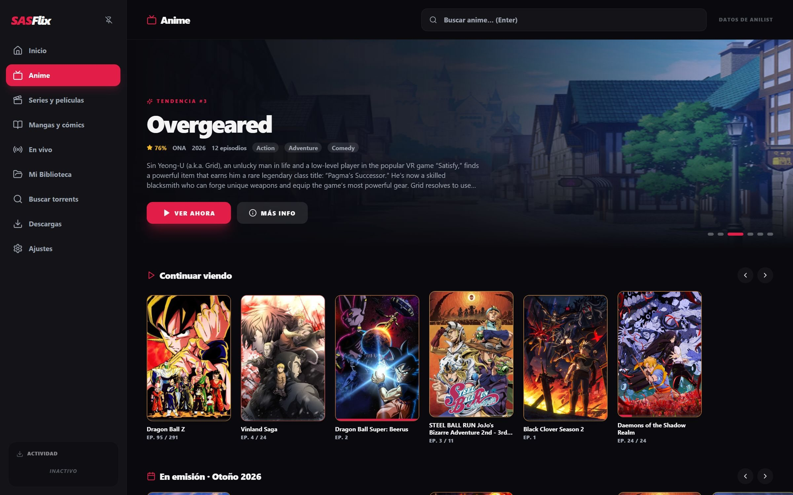
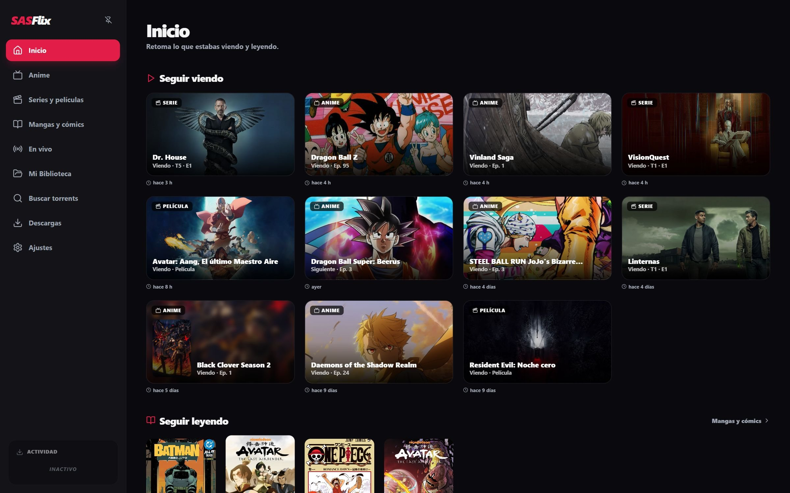
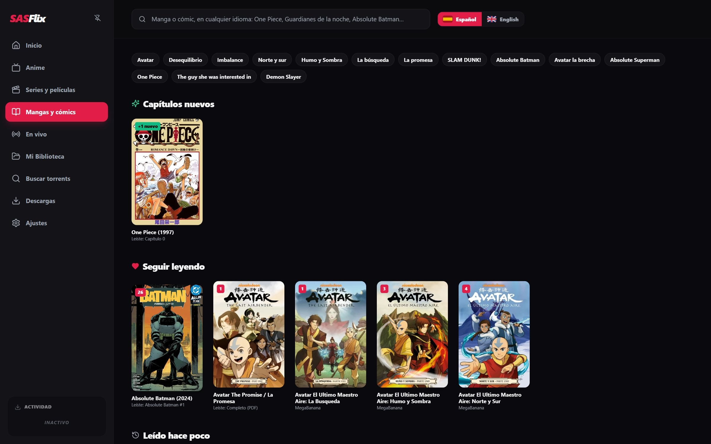

# SASFlix

### Tu próximo capítulo ya te está esperando.

Anime, series, películas y mangas en una sola app para Windows, con subtítulos en español.

**[⬇ Descargar para Windows](https://github.com/CdeCevin/SASFlix/releases/latest/download/SASFlix-Setup.exe)**
&nbsp;·&nbsp; [Todas las versiones](https://github.com/CdeCevin/SASFlix/releases)

---

## Qué es

SASFlix junta en un solo lugar lo que normalmente son cinco programas: buscar qué ver, encontrar una versión
que funcione, conseguir subtítulos en español, reproducirlo y acordarte de en qué capítulo ibas. Eliges el
capítulo y empieza en segundos. No hay cuentas, ni anuncios, ni nada que configurar.

## Lo que hace

**Sigue justo donde quedaste.** Al abrir SASFlix, Inicio muestra lo que estabas viendo y leyendo, en el minuto exacto.

**Empieza en segundos.** No esperas a que termine una descarga. En anime, el capítulo arranca al instante en
720p y pasa solo a 1080p cuando la versión en alta calidad está lista, en el mismo segundo y sin cortes.

**Subtítulos en español, siempre.** Si el video no trae español, SASFlix busca subtítulos en otra versión del
mismo capítulo o en sitios de subtítulos, y los sincroniza con la voz.

**Subtítulos, latino o castellano.** Cada serie recuerda tu idioma. Con doblaje elegido, SASFlix busca esa
versión y pone esa pista de audio.

**El siguiente capítulo ya está listo.** Mientras ves uno, el que viene se va preparando.

**Guárdalo para después.** Descarga un capítulo, una temporada o la serie completa a una carpeta de tu PC y
mírala sin internet. Esa carpeta es tu biblioteca.

**Mangas y cómics.** En español o inglés, de corrido, por página o a doble página. Los capítulos nuevos de lo
que sigues aparecen en Inicio.

**Deportes en vivo.** Agrega tus fuentes de deportes (compatibles con addons de Stremio) y mira partidos y
canales en directo, con las transmisiones en español primero.

**A tu gusto.** Varios temas de color, modo negro puro para pantallas OLED y subtítulos con el tamaño, color y
fondo que prefieras.

## Instalación

1. Descarga **[SASFlix-Setup.exe](https://github.com/CdeCevin/SASFlix/releases/latest/download/SASFlix-Setup.exe)** (unos 500 MB).
2. Ábrelo y sigue el instalador.
3. Windows puede mostrar **"Windows protegió su PC"** porque el instalador no tiene firma digital de pago.
   Haz clic en **Más información → Ejecutar de todas formas**.
4. Al abrir SASFlix por primera vez, un recorrido corto te muestra lo principal.

**Requisitos:** Windows 10 u 11 de 64 bits y conexión a internet. Todo lo demás viene incluido.

## Cómo funciona (para curiosos)

SASFlix es una app de escritorio con dos partes que corren en tu PC:

| Parte | Tecnología | Qué hace |
|---|---|---|
| Interfaz | Electron, React, TypeScript, Tailwind | La app que ves: fichas, Inicio, lector de mangas, ajustes |
| Motor | Python (FastAPI), empaquetado con PyInstaller | Busca, descarga, prepara subtítulos y controla el reproductor, sólo en `127.0.0.1` |
| Reproductor | VLC (incluido), integrado en la ventana | Reproduce mientras descarga, con controles propios |
| Video | ffmpeg (incluido) | Lee pistas y resolución real, alinea subtítulos |
| Descargas | libtorrent | Descarga por partes en el orden en que se ve el video |
| Mangas | Suwayomi (incluido, con su propio Java) | Busca y sirve capítulos de manga y cómics |
| Datos | AniList, TMDB | Portadas, sinopsis, temporadas y episodios |

Algunos detalles de cómo logra empezar rápido y en español:

- **Carrera de fuentes.** Para cada capítulo prueba varias versiones a la vez y se queda con la que responde
  primero, siempre dentro de las que cumplen lo pedido (calidad, idioma, doblaje).
- **Descarga en orden de lectura.** Primero baja el comienzo del capítulo y el índice del archivo, así VLC puede
  empezar y saltar a cualquier minuto sin esperar el archivo completo.
- **Cambio a 1080p sin cortes.** Mientras ves la versión inmediata, baja el tramo que viene de la versión en
  alta calidad y cambia en el mismo segundo. Antes de cambiar comprueba la resolución real del video y que sea
  el mismo capítulo.
- **Subtítulos alineados por la voz.** Los subtítulos que vienen de otra versión se sincronizan detectando
  dónde se habla en el audio, no sólo por tiempos.

**Privacidad:** no hay cuentas ni servidores de SASFlix. Tu historial, ajustes y biblioteca quedan en tu PC
(`%APPDATA%\SASFlix` y la carpeta de descargas que elijas). El motor sólo acepta conexiones desde tu propio equipo.

## Preguntas frecuentes

**¿Cuánto cuesta?** Nada. SASFlix es gratis y no tiene anuncios.

**¿Necesito configurar algo?** No. Eliges qué ver y SASFlix se encarga del resto.

**¿Dónde quedan las descargas?** En la carpeta que eliges en Ajustes. Desinstalar SASFlix no la borra.

**¿Por qué el instalador pesa tanto?** Trae todo incluido: el reproductor, ffmpeg y el servidor de mangas con
su Java, para que no tengas que instalar nada aparte.

**¿Se actualiza solo?** Todavía no. Las versiones nuevas aparecen en
[Releases](https://github.com/CdeCevin/SASFlix/releases); el enlace de descarga de arriba siempre entrega la última.

**¿SASFlix incluye películas, series o mangas?** No. SASFlix no aloja ni vende contenido: lo busca en fuentes
públicas de internet y lo reproduce en tu equipo. Las descargas usan redes P2P, así que mientras bajas algo
también lo compartes con otras personas. Cada usuario es responsable de usarlo según las leyes de su país.

## Novedades de la 2.3.0

- **En vivo:** deportes y canales en directo con fuentes compatibles con addons de Stremio, con las
  transmisiones en español primero y descartando las que no funcionan.
- **Latino y castellano:** elige el idioma en cada ficha; SASFlix busca esa versión y pone esa pista de audio.
- **Subtítulos a tu gusto:** tamaño, color, fondo y borde en Ajustes → Reproductor.
- **Más estable al cambiar de capítulo o de serie:** lo que ves ya no compite con lo que se prepara en
  segundo plano, y el siguiente capítulo se baja de forma más confiable.
- Si no tienes Google Chrome, SASFlix usa Microsoft Edge para las fuentes que lo necesitan.

---

SASFlix es un programa para buscar, organizar y reproducir contenido. No aloja ni vende contenido y no está
afiliado a ningún servicio de streaming. Este repositorio sólo publica el instalador; el código no es público.

© 2026 SASFlix

